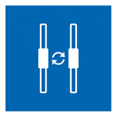
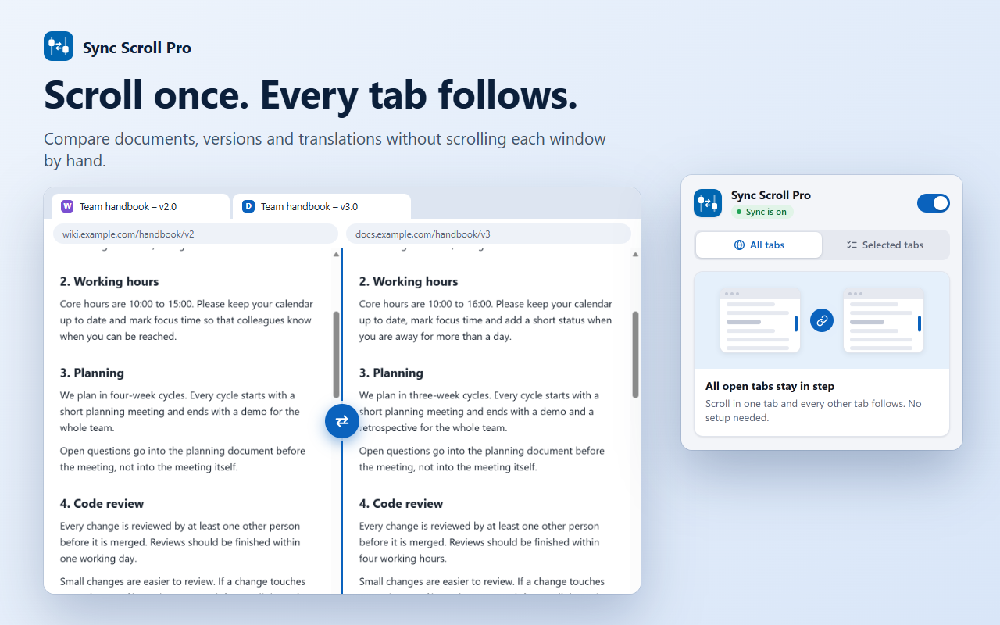
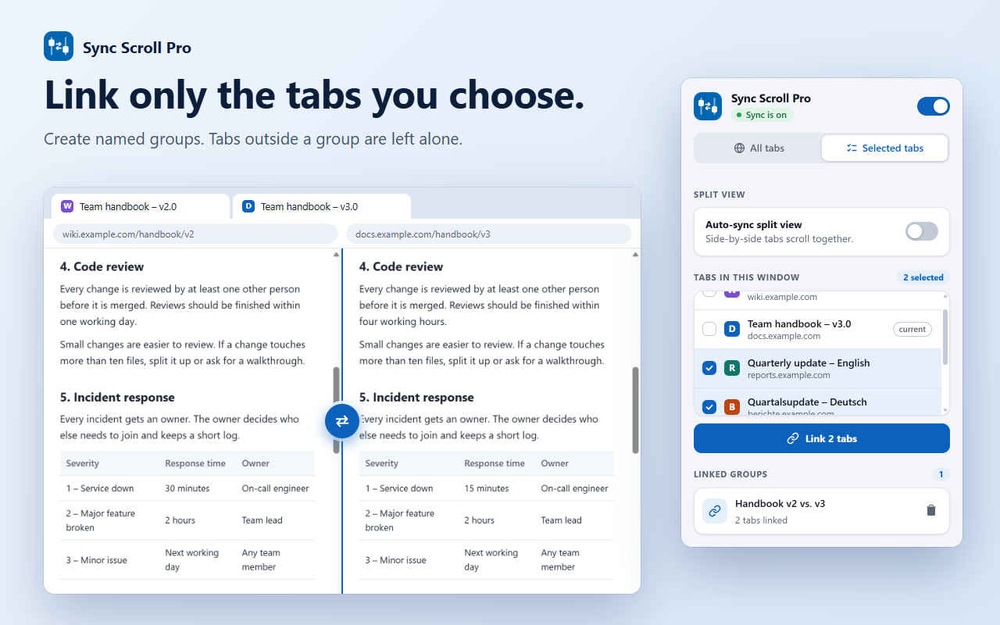
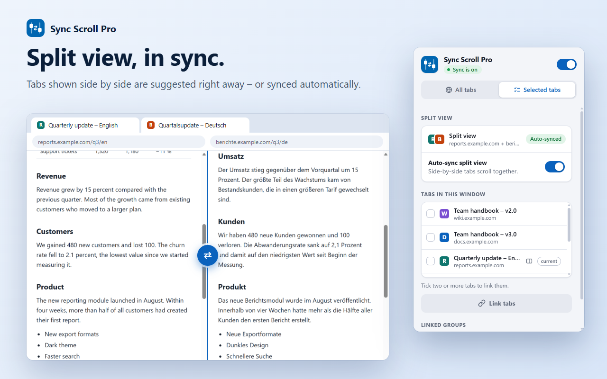
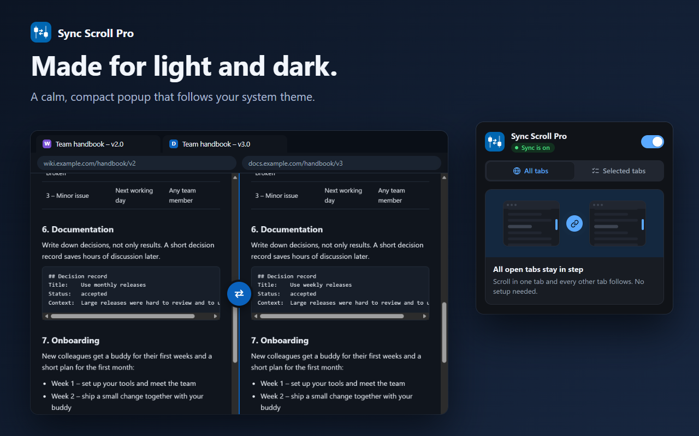

<h1 align="center">Sync Scroll Pro</h1>

<b>Synchronize scrolling across multiple browser tabs, globally or in custom groups. Ideal for comparing documents, translations and pages side by side.</b>

  
  
  
  
  

## Features

| Feature | Description |
|---|---|
| **Global mode** | All open tabs scroll together automatically, with nothing to set up. |
| **Targeted mode** | Create named sync groups with exactly the tabs you choose. |
| **Split view** | Tabs shown side by side are suggested right away; link them with one click. |
| **Auto-sync split view** | Optional: tabs in a split view scroll together automatically, no linking needed. |
| **Two-way sync** | Scroll in any synced tab and all the others follow. |
| **Inner scrollers** | Also works on app-style pages where a container, not the page, scrolls. |
| **Rename and delete groups** | Click a group name to rename it; remove a group with one click. |
| **Master switch** | Pause everything instantly without uninstalling. |
| **Remembered settings** | Mode, master switch and the split view option survive browser restarts. |
| **Automatic cleanup** | Closed tabs are removed from groups. Groups are cleared when the browser restarts, because tab IDs change. |

| | |
|---|---|
|  |  |
|  | |

## Install

- **Chrome, Brave and other Chromium browsers:** [Chrome Web Store](https://chromewebstore.google.com/detail/mmnagcdibimlgbbdlkkdliojojignoda)
- **Microsoft Edge:** [Edge Add-ons](https://microsoftedge.microsoft.com/addons/detail/sync-scroll-pro-tab-scr/jagebhfpngcppjngngieadoljohgombf)
- **From source:** see [Development](#development).

## Getting started

**Global mode** (default)

1. Click the extension icon and make sure the master switch is on.
2. Keep **All tabs** selected. Every open tab now scrolls together.

**Targeted mode**

1. Click the extension icon and switch to **Selected tabs**.
2. Tick two or more tabs and click **Link tabs**.
3. Only the tabs in the same group mirror each other.

**Split view**

Needs a browser version that offers split view to extensions (tested with Brave 158 and Edge 158). Without it, everything else works and the split view section stays hidden.

1. Open two tabs side by side in a split view.
2. Click the extension icon, choose **Selected tabs**. The split pair is suggested at the top; click **Link**.
3. Or turn on **Auto-sync split view**: every split view scrolls together automatically.

**Troubleshooting**

- Nothing syncs on a tab: browsers do not let extensions run on their own pages (`chrome://`, `edge://`, the new tab page) or in the extension stores. Those tabs are greyed out in the popup and cannot be linked.
- After updating the extension, open tabs are picked up automatically; no page reload is needed.

## Permissions and privacy

Everything runs locally on your device. No accounts, no tracking, no network requests, no browsing history. Read the [privacy policy](privacy-policy.html).

| Permission | Why it is needed |
|---|---|
| `tabs` | list your open tabs, pass scroll positions between linked tabs and detect split views |
| `storage` | remember your settings and groups on this device |
| `scripting` and access to all sites | a page's scroll position can only be read from inside that page; after an install or update the bundled script is started in tabs that are already open |

## Support

- Questions, bugs or ideas: [open an issue](https://github.com/exUs541/SyncScroll/issues).
- More about Sync Scroll Pro and the other extensions: [exus541.github.io/portfolio](https://exus541.github.io/portfolio/index.html), with a [feedback form](https://exus541.github.io/portfolio/feedback.html).

## Development

The extension runs straight from this folder, there is no build step.

1. Clone the repository.
2. Open `chrome://extensions` (or `edge://extensions`) and switch on **Developer mode**.
3. Choose **Load unpacked** and select the repository folder.

| Path | Purpose |
|---|---|
| `manifest.json` | extension manifest (Manifest V3) |
| `background.js` | service worker: routes scroll messages, finds split view partners |
| `content.js` | injected into every page: sends and applies scroll positions |
| `popup.html`, `popup.js`, `popup.css` | popup (follows the system light or dark theme) |
| `icons/` | extension icons |
| `store-assets/` | store texts and screenshots, see its [README](store-assets/README.md) |
| `.github/` | release pipeline, see [RELEASING.md](.github/RELEASING.md) |

Data flow: a tab scrolls, `content.js` tells `background.js`, which tells `content.js` in the linked tabs, and they scroll to the same position.

Pull requests are welcome. For larger changes, please open an issue first.

## License

Released under the [MIT License](LICENSE).
